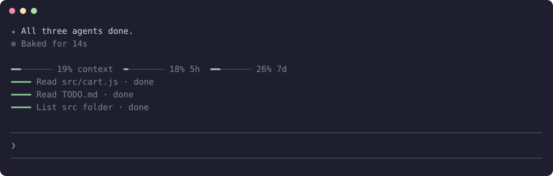
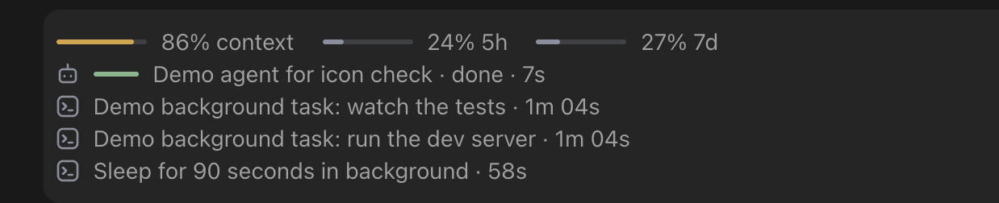

<h1 align="center">claude-bars</h1>

<p align="center"><b>Your context and plan limits as one quiet line, with every subagent, test run and background task and how long each has been running.</b></p>

<p align="center">
  
  
  
  
</p>

<p align="center"></p>

<p align="center"><sub>Only this mod enabled, combined from two real terminal sessions: agents, then background commands with their timers.</sub></p>

Know how much room you have left, and what is still running, at a glance. That dev server Claude started twenty minutes ago stays in view with its description and a running clock. It makes no model calls.

## Install

In a terminal, inside Claude Code:

```
/plugin install bars --marketplace YlitaloJuha/claude-bars
```

Or from a shell:

```bash
claude plugin install bars --marketplace YlitaloJuha/claude-bars
```

In the desktop app, click + next to the prompt box, then Plugins, Add marketplace with `YlitaloJuha/claude-bars`, then Add plugin.

## What it does

- **Context and limits:** Context window, 5-hour and 7-day limits as thin bars. The limit bars only change colour from 70% used.
- **Smart zone:** The context bar is green up to 100k tokens, where the model does its best work, and orange-red past it, whatever the window's size. It turns red at 90% of the window.
- **Test runs:** Each test run Claude starts, in the foreground or background, with its description and a counting timer. It ends as `passed`, `failed`, `stopped` or `ended`, and clears on your next message.
- **Test runs elsewhere:** A process scan every 10 seconds finds runs outside this session, such as in your terminal or another Claude session. They show their command and true running time, and end as `ended`, since their exit code can't be read.
- **Background tasks:** Each background command with a terminal icon, its description and a counting timer. It leaves the list when it ends.
- **Agents:** Each subagent with an icon, a thin bar, its task, tool count and running time. The bar fills when the agent ends.
- **Stays small:** The newest four of each show. Older ones fold under `+2 more` and open when you hover over the list.
- **Compact button:** Appears on the line from 70% context, and hides while a turn runs.
- **Works alone, shares when it can:** If you also install [`claude-afk`](https://github.com/YlitaloJuha/claude-afk), [`claude-wrap-up`](https://github.com/YlitaloJuha/claude-wrap-up) or [`claude-todos`](https://github.com/YlitaloJuha/claude-todos), they put their controls on this line instead of their own row.

<p align="center"></p>

<p align="center"><sub>In the desktop app: a finished agent and three background tasks, with icons and running times. The tasks are demos, and the context bar has turned amber at 86%.</sub></p>

## Commands

| Command | What it does |
|---|---|
| `/bars` | Print your context and plan limits |

## What it costs

None. It makes no model calls.

## What it can reach

No network and no file access through the mod API. It runs two commands: `ps` every 10 seconds, and `sh -c 'echo $PPID'` once at the start to tell this session's runs from the rest. `ps` lists the command line of every process on your machine. The mod keeps only the ones it reads as test runs, in this session's state, and sends them nowhere. It reads usage and the subagent list from Claude Code, and runs `/compact` only when you press the button. Run `claude plugin validate .` in this repository to list every call it makes.

## Limits

- Claude Code reports no percent-done for an agent, so a subagent bar shows activity: it grows with tool calls up to 90%, then fills when the agent ends.
- Agents and background tasks are this session's only. From separate sessions, only test runs are listed.
- A test run Claude starts is recognised from its Bash command: common runners, a tool's `test` target, or a script named for tests. A command that doesn't read as one, such as `./ci.sh` or `sh -c "pytest"`, can still show through the scan if it starts a known runner, but with no verdict.
- The process scan is narrower, as it reads every process on the machine: it looks for known runners and tools' `test` targets, on this machine only. A script named for tests shows only if it starts a known runner. It skips `--watch` modes and runs inside containers, and misses a runner whose path has a space in it.
- The scan can miss a run shorter than 10 seconds, and a scanned run's end can show up to 10 seconds late.
- A test row shows no pass count or live progress, since a mod only gets a command's output once it has ended. Its clock starts when Claude asks to run the command, so it includes any wait for your approval. A background run's clock stops when Claude Code reports its end, which can be a little later than the end itself.
- A pipe or `;` hides the runner's exit code. A foreground run then takes its verdict from its output. A background run shows `ended` unless it reports a failure.
- The 100k line is a rule of thumb, not something Claude Code measures.
- The hover list has only been checked in tests, and it needs a pointer: where there is none, the older rows stay folded.
- Tasks are known from the moment they start in this session, so ones started before a resume are not listed.
- If you use the `skins` mod, run `/skin band off` so its rings do not show as well.
- Claude Code draws the band above the prompt only in the terminal and the desktop app, so what this mod draws there does not show in VS Code or on mobile.

## Develop

```bash
claude plugin validate .
claude plugin test .
claude --plugin-dir .
```

## Make it yours

Once it is loaded, ask your own Claude to fit it to how you work, for example to change when the bars turn amber, or how many rows show. The code is in `hooks/register.tsx`, and the license allows changes. Keep your version in a fork, so an update does not replace it. What you change is yours to check.

## Credits

- The idea of a usage band above the prompt, and the way Compact gets its own dispatch, come from [skins](https://github.com/hellosverre/claude-skins) by hellosverre (MIT).
- The list of prompt origins no person sent comes from [cache-tax](https://github.com/karanb192/cache-tax) by Karan Bansal (MIT).

## Try other mods together

This mod works on its own, and it also works side by side with my other Claude Code mods. See [the full list on my profile](https://github.com/YlitaloJuha/YlitaloJuha#claude-code-mods).

## License and warranty

[MIT](LICENSE). `THIRD_PARTY_LICENSES.md` covers the parts that came from other projects.

Provided **as is, with no warranty of any kind**. You use it at your own risk, and the author is not liable for anything that results from using it, including lost work, usage charges or changes to your code.

**It may break.** It relies on how Claude Code works today, and has been tested on versions 2.1.292 and 2.1.309. It may stop working after a future update if Anthropic changes things.

This is an independent, unofficial project. It is not affiliated with, endorsed by or supported by Anthropic.
